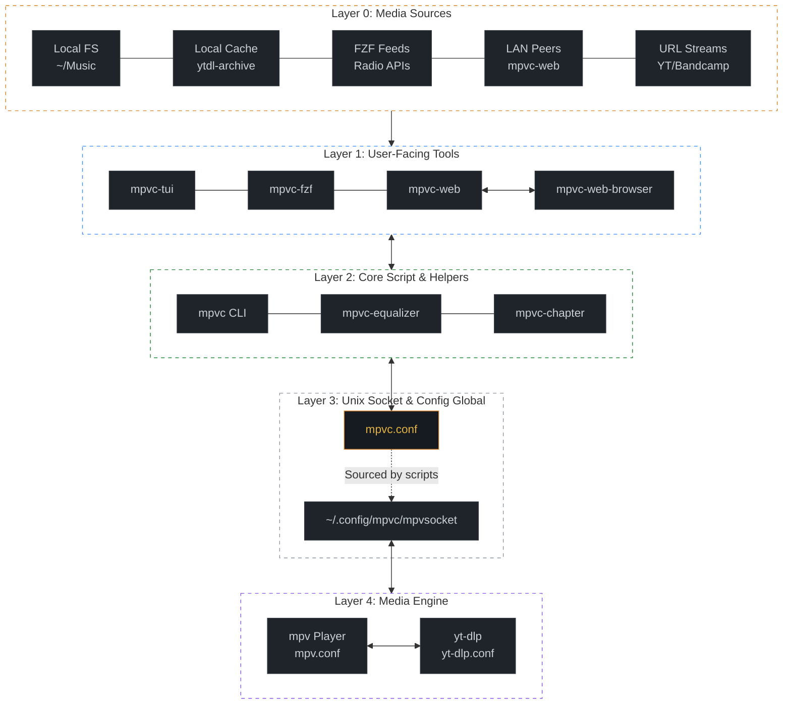

> [!WARNING]
> **Documentation has moved:** This file is kept for historical reference. See the up-to-date documentation at **[gmt4.github.io/mpvc](https://gmt4.github.io/mpvc/)**.

# 🎧 mpvc


[ [Intro](#%EF%B8%8F-overview-1) | [Reqs](#requirements) | [Install](#installation) | [Config](#configuration) | [Docs](#documentation) | [Usage](#usage) ]

Music player in POSIX-sh using mpv from the shell/fzf + extras/goodies [^install] 📡🛸🚀.

A fork of [lwillets/mpvc](https://github.com/lwilletts/mpvc) evolving on its own adding features such as: improved interfaces to CLI, TUI, FZF, WEB, EQZ, & play streaming services as YouTube/Invidious, with a focus on being fully programmable/scriptable from the shell.
For more on the features of this fork check: [Git](#git) install, [LogBook](#logbook) & [Casts](#screencasts).

⏩ Skip directly to [Installation](#installation) to try mpvc!

<details>
<summary>mpvc-fzf running on macOS <i>(click to view screenshot)</i></summary>


</details>

<details>
<summary>mpvc-tui -T: running the mpvc TUI (with albumart) <i>(click to view screenshot)</i></summary>


</details>

<details>
<summary>mpvc-tui -T: running the mpvc TUI <i>(click to view screenshot)</i></summary>


</details>

<details open>
<summary>mpvc-fzf -f: running with fzf to manage the playlist <i>(click to view screenshot)</i></summary>


</details>

<details open>
<summary>mpvc-tui -n: running with mpvc-fzf and desktop notifications on the upper-right corner <i>(click to view screenshot)</i></summary>


</details>

## ▶️ Overview [^install]

`mpvc` is a collection of POSIX shell scripts:

- [mpvc](../../blob/master/mpvc): provides the core CLI commands to control mpv
- [extras/mpvc-tui](../../blob/master/extras/mpvc-tui): provides a console TUI, using mpvc underneath
- [extras/mpvc-fzf](../../blob/master/extras/mpvc-fzf): provides FZF integration to mpvc.
- [extras/mpvc-web](../../blob/master/extras/mpvc-web): web player to remotely control mpvc (a hack)
- [extras/mpvc-web-browser](../../blob/master/extras/mpvc-web-browser): mpvc-web companion to browse media library (a hack)
- [extras/mpvc-mpris](../../blob/master/extras/mpvc-mpris): speaks MPRIS to control mpv player through key-bindings.
- [extras/mpvc-equalizer](../../blob/master/extras/mpvc-equalizer): provides a basic mpv equalizer for the CLI.
- [extras/mpvc-autopilot](../../blob/master/extras/mpvc-autopilot): automatic mpv start/stop based on presence.
- [extras/mpvc-installer](../../blob/master/extras/mpvc-installer): provides an installer to install/update mpvc.

For more details on how to use the above tools have a look at the [Git](#git) install guide and the [LogBook](#logbook).
In addition, the [casts/](#screencasts) directory to shows some screencasts of mpvc in action.

## Requirements

Required:
- `sh`: a POSIX compliant shell (`/bin/sh` works)
- `mpv`: the mpv media player (see https://mpv.io)
- `socat`: is preferred due to the differing implementations of `netcat` across UNIXes.
- `awk`: a sane version of `awk` for the same reason (GNU/BSD `awk` works)

Recommended extras:

- `curl`
- `fzf`
- `jq`
- `yt-dlp`
- `mpv-mpris`
- `notify-send`
- `beets`
- `cava`

>[!WARNING]
> **Note tools must be up to date**, in special `yt-dlp` to play streaming services, run `mpvc-installer check-reqs|config-user` to check and update.

## Installation

- [Curl](#curl)
- [Git](#git)
- [Debian](#debian)
- [Arch](#arch-mpvc-git)
- [BSD](#bsd)
- [MacOS](#macos)
- [Gentoo](#gentoo-mpvc)
- [Nix](#nix-mpvc)

Installing is just a matter of fetching the scripts either via [Git](#git)/[Curl](#curl)/etc., scripts can be used directly from the repo, the `mpvc-installer` bit is just there for easiness, to fetch & link them into your `BINDIR=~/bin/` that [mpvc-installer](../../blob/master/extras/mpvc-installer) does by default.

The easiest for a onetime install is using [Curl](#curl), however for the @latest and keeping always updated a [Git](#git) install is recommended.

### Curl

Fetch the mpvc-installer (written in POSIX-sh), and ensure it runs under a POSIX-sh SHELL

* __Zen Install__ achieve inner peace of mind before piping to your shell.


```console
curl -fsSLO https://github.com/lwilletts/mpvc/raw/master/extras/mpvc-installer;
# take your time to review the mpvc-installer for peace-of-mind
BINDIR=$HOME/bin SHELL=/bin/sh $SHELL ./mpvc-installer quickstart
```

* __YOLO Install__ fast, but you're trusting the pipe (curl|sh).


```console
curl -fsSLO https://github.com/lwilletts/mpvc/raw/master/extras/mpvc-installer \
  && SHELL=/bin/sh BINDIR=$HOME/bin sh ./mpvc-installer quickstart
```

### Git

Clone the git repo to receive quick development updates via `git pull`, then, use the `mpvc-installer` inside the repo:

```sh
 # fetch a local copy of the github repo
 git clone https://github.com/gmt4/mpvc/

 # use extras/mpvc-installer: just copy/link to BINDIR=$HOME/bin
 (cd mpvc; BINDIR=~/bin/ extras/mpvc-installer quickstart-ln)
```

Once installed, you can start using mpvc, below are some examples to get started:

```
 # use mpvc to add/load/save media files or online YT URLs
 mpvc add /path/to/your/*.mp3 # or your URLs
 find . -type f -name '*.mp3' | mpvc load
 fzf | mpvc load # even better than the above
 mpvc save my-playlist

 # use mpvc stash to store/recover current mpv state
 mpvc stash ls
 mpvc stash push current
 mpvc stash apply current

 # use mpvc-fzf to manage mpvc stash (see mpvc-fzf -h for more)
 mpvc-fzf -a
 # use mpvc-fzf to search and play youtube media
 mpvc-fzf -p 'kupla mirage'
 # use mpvc-fzf to browse & play lofi girl music (archive.org)
 mpvc-fzf -b https://archive.org/download/lofigirl-youtube/mp3/
 # use mpvc-fzf to randomly enqueue a few lofi tracks (see mpvc-fzf lofi)
 mpvc-fzf -B https://archive.org/download/lofigirl-youtube/mp3/ | shuf -n 128 | mpvc load
 # use mpvc-fzf to manage the playlist
 mpvc-fzf -f
 # use mpvc-tui to start the tui + desktop notifications
 mpvc-tui -T
```

For more  check the  [LogBook](#logbook) (remember your best chance is to try, play, learn, and have fun).

### Debian

Debian (and APT derivatives such as Ubuntu):

```console
apt install mpv awk curl socat fzf rlwrap jq libnotify-bin # mpv-mpris cava
```

### Arch [mpvc-git](https://aur.archlinux.org/packages/mpvc-git)

Arch (and derivatives):

```console
pacaur -y mpvc-git
pacman -Sy mpv awk curl socat fzf rlwrap jq libnotify # cava
````

### BSD

BSD systems as OpenBSD and NetBSD using pkg_add(1) see [FAQ](../../blob/master/docs/FAQ.md):

```console
pkg_add mpv curl socat fzf rlwrap jq libnotify # mpv-mpris cava python3
```

BSD systems as FreeBSD using pkg(1) see [FAQ](../../blob/master/docs/FAQ.md):

```console
pkg install -y mpv curl socat fzf rlwrap jq libnotify # mpv-mpris cava python3
```

### MacOS

MacOS (and brew(1) based derivatives see [FAQ](../../blob/master/docs/FAQ.md)):

```console
brew install mpv curl socat fzf rlwrap jq libnotify yt-dlp # cava
```

### Gentoo [mpvc](https://gitlab.com/xy2_/osman)

```console
emerge mpvc
```

### Nix [mpvc](https://github.com/NixOS/nixpkgs/blob/master/pkgs/by-name/mp/mpvc/)

```console
nix-env -i mpvc
```

## Configuration

Running `mpvc-installer config-user`, just installs the default configuration files from [config/](../../blob/master/docs/config/) listed below under `~/.config/mpvc/`, afterwards, check and adjust them to suit your needs.

- `mpvc` configuration is performed on [config/mpvc.conf](../../blob/master/docs/config/mpvc.conf).

- `mpv` configuration is performed on [config/mpv.conf](../../blob/master/docs/config/mpv.conf).

- `yt-dlp` configuration is performed on [config/yt-dlp.conf](../../blob/master/docs/config/yt-dlp.conf).

- `shell` aliases to type less [config/bash_aliases.mpvc](../../blob/master/docs/config/bash_aliases.mpvc).

- `$TERM` configuration: A decent terminal with color/sixels support is recommended (`256color/vt340`), but outside of the scope of `mpvc` config.

### QuickConfig

For a quick config just copy/symlink docs/config/ to ~/.config/mpvc/

```console
# either use `mpvc-installer config-user` or do the cp/symlink by hand
cd mpvc/
ln -f -s $PWD/docs/config/mpv.conf ~/.config/mpv/
ln -f -s $PWD/docs/config/mpvc.conf ~/.config/mpvc/
ln -f -s $PWD/docs/config/yt-dlp.conf ~/.config/mpvc/

```

## Documentation

### Manuals

* [docs/man/](../../blob/master/docs/man/)
: For the `mpvc(1)` command read the mpvc manual page.

* [https://mpv.io/manual/stable/](https://mpv.io/manual/stable/)
: For the `mpv(1)` command read the mpv reference manual.

* [logbook](#logbook)
: For the functionality specific of this [fork](https://github.com/gmt4/mpvc) your best aim is the [logbook](#logbook)

### Logbook

The logbook (blog) is a companion of mpvc that covers mpvc usage & evolution:

* [https://gmt4.github.io/mpvc/logbook.html](https://gmt4.github.io/mpvc/logbook.html)

### Screencasts

Have a look at the screencasts to watch mpvc in action.

* [https://gmt4.github.io/mpvc/casts/](https://gmt4.github.io/mpvc/casts/)

### FAQ

Check the FAQ for any questions left after reading the above docs.

* [docs/FAQ.md](../../blob/master/docs/FAQ.md)

### Issues

If you encounter a bug file an [Issue](../../issues).

[^install]: Skip directly to [Installation](#installation) to try mpvc

## Ecosystem Architecture

The following diagram maps how media inputs flow down through the user-facing tools, core scripts, and runtime configuration layers to drive the underlying playback engine:



### Which Component Should You Run?

The mpvc ecosystem is completely modular. You only need to spin up the specific components that match your active media setup:

* **mpvc**
  The core CLI POSIX engine for automation and window manager keybindings. (manual: [mpvc(1)](https://gmt4.github.io/mpvc/man/man1/mpvc.html))
  * **Quickstart:** `mpvc add <URL/Path>` or `mpvc toggle`

* **mpvc-tui**
  A continuous terminal console displaying status, playlists, and desktop notifications. (manual: [mpvc-tui(1)](https://gmt4.github.io/mpvc/man/man1/mpvc-tui.html))
  * **Quickstart:** `mpvc-tui -t` (or `mpvc-tui -T` for notifications)

* **mpvc-fzf**
  A keyboard-driven fuzzy browser for media: local music libraries, radio APIs, and YouTube streams. (manual: [mpvc-fzf(1)](https://gmt4.github.io/mpvc/man/man1/mpvc-fzf.html))
  * **Quickstart:** `mpvc-fzf -p 'query'` or `mpvc-fzf --lofi`

* **mpvc-web**
  A lightweight HTTP daemon and CGI asset manager to control playback from a phone or tablet browser. (manual: [mpvc-web(1)](https://gmt4.github.io/mpvc/man/man1/mpvc-web.html))
  * **Quickstart:** `mpvc-web -c start`

* **mpvc-equalizer**
  A 15-band linear phase equalizer to manipulate audio streams and load acoustic environment presets. (manual: [mpvc-equalizer(1)](https://gmt4.github.io/mpvc/man/man1/mpvc-equalizer.html))
  * **Quickstart:** `mpvc-equalizer preset classical | mpvc-equalizer load`

* **mpvc-chapter**
  A local tool to quickly build, adjust, and merge custom timestamp markers into media files. (manual: [mpvc-chapter(1)](https://gmt4.github.io/mpvc/man/man1/mpvc-chapter.html))
  * **Quickstart:** `mpvc-chapter add` or `mpvc-chapter load`

* **mpvc-autopilot**
  A background script to autopilot mpvc: pauses or resumes playback dynamically based on local network IP pings or Bluetooth proximity. (manual: [mpvc-autopilot(1)](https://gmt4.github.io/mpvc/man/man1/mpvc-autopilot.html))
  * **Quickstart:** `mpvc-autopilot -p 300 -n 3 -i <target_ip>`

* **mpvc-installer**
  An automated installer/deploy shell script tool for seamless installer setups, dependency checking, and complete removals. (manual: [mpvc-installer(1)](https://gmt4.github.io/mpvc/man/man1/mpvc-installer.html))
  * **Quickstart:** `mpvc-installer quickstart`

